# Back-end review — 27 November 2026

The staff and owner side of the app, read page by page as the owner and as an
employee, on a day with people in it. Findings are ranked by **how often staff
hit the page × how much it costs them**. What was fixed in this pass is marked
**Fixed** with the test that holds it; what was left is marked **Open** with the
reason.

## How it was read

- Every staff page was rendered through the test harness on a copy of the local
  database: 289 owner pages and 70 employee pages, plus 32 that need a record
  that doesn't exist yet.
- A realistic Thursday was seeded on top. It has stays arriving, in and leaving,
  a family owing a balance, a VIP with a nut allergy, four dinners (one waiting
  for an answer), extras due, prep checklists, two people clocked in, a wedding
  enquiry, workshop registrations, a fridge reading out of range, an incident, a
  room issue, stock, and pending expenses and time off.
- Each page was screenshotted at desktop width and at 390 px with a touch screen
  (inside an iframe, because headless Chrome won't go narrower than about 500 px).
  The phone render was also measured for overflow and for buttons past the right
  edge.
- Six read-only auditors took one sidebar area each. The employee side and the
  start pages were read directly. Every finding below was checked against the
  code.
- Numbers to keep in mind:
  - Every page answered in under 300 ms.
  - No table sits outside a `table-wrap`, and no page body scrolls sideways on a
    phone.
  - Every owner page has at least one link to it.

## Before and after

| | |
|---|---|
| 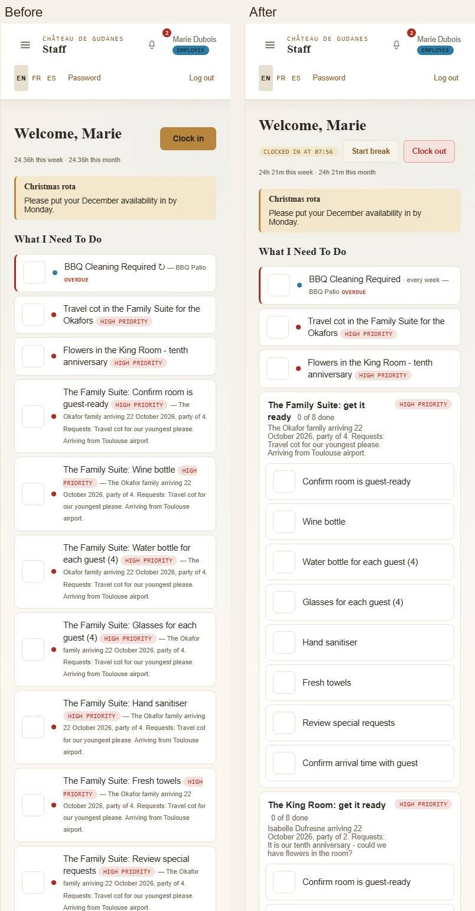 | 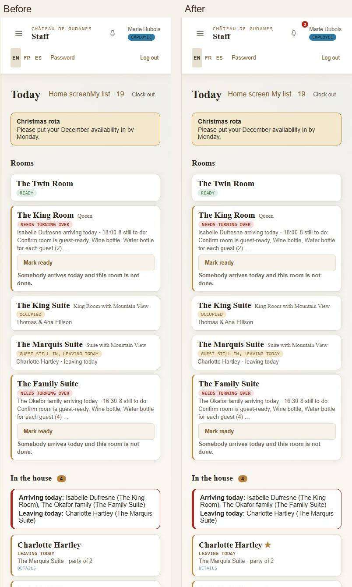 |
| **Home** (where an employee lands after signing in): "Clock in" while clocked in, and a room's checklist as sixteen rows repeating one sentence. | **Today**: "Home screenMy list" run together; guests not yet arrived read "Arrived today"; each request printed twice. |
| 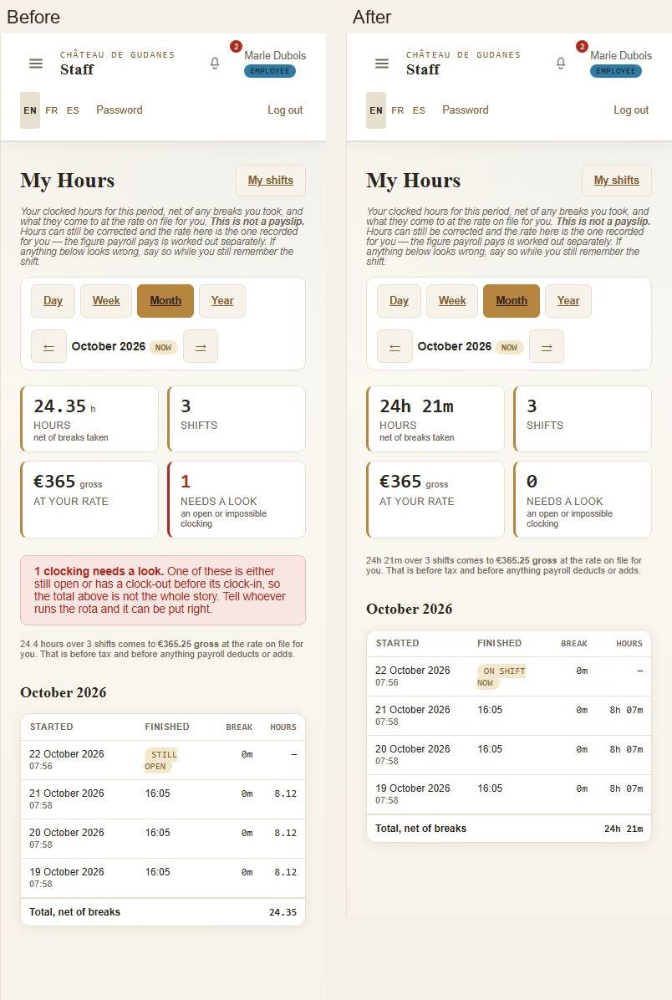 | 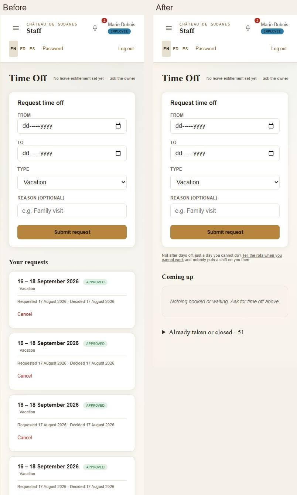 |
| **My Hours**: "8.12" for 8h 07m; the shift being worked flagged "needs a look". | **Time Off**: Cancel offered on every holiday already taken; the new request buried under the old ones. |
| 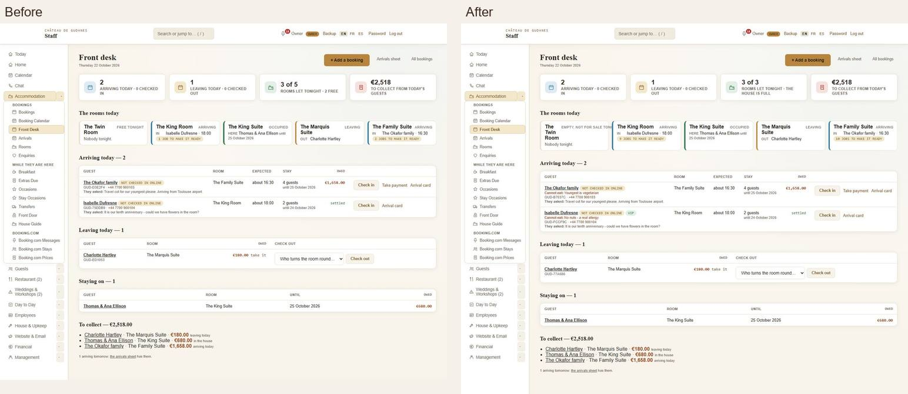 | 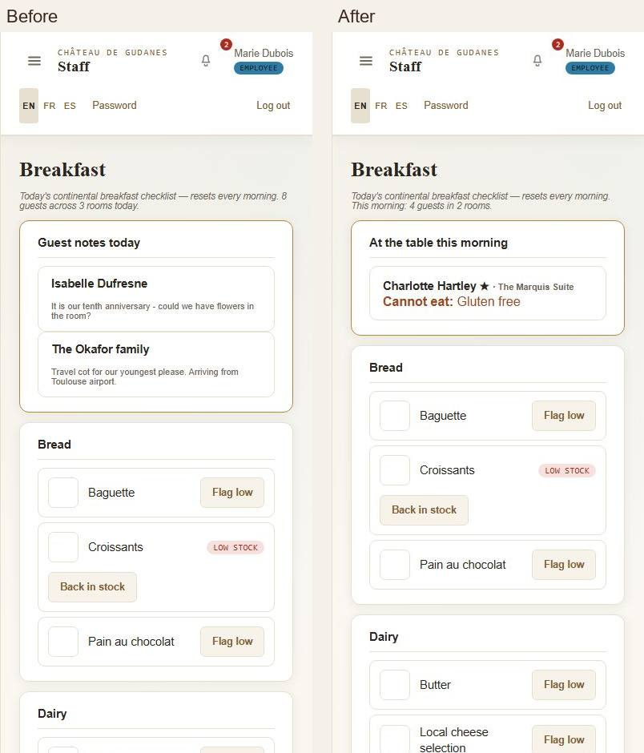 |
| **Front Desk**: no "Cannot eat" or VIP; "room ready" without the room's checklist; "2 free" with the house full. | **Breakfast**: counted tonight's guests, not this morning's; listed room requests, not allergies. |
| 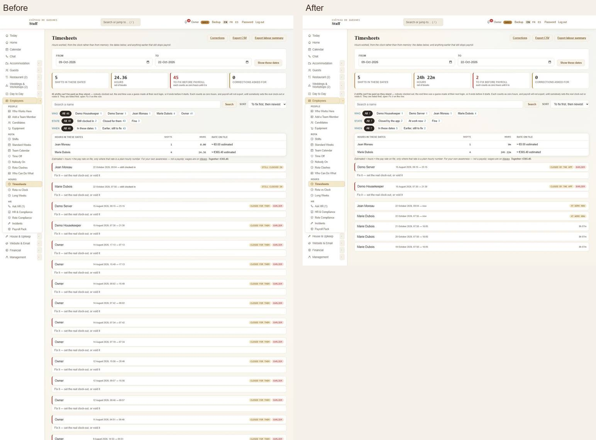 | 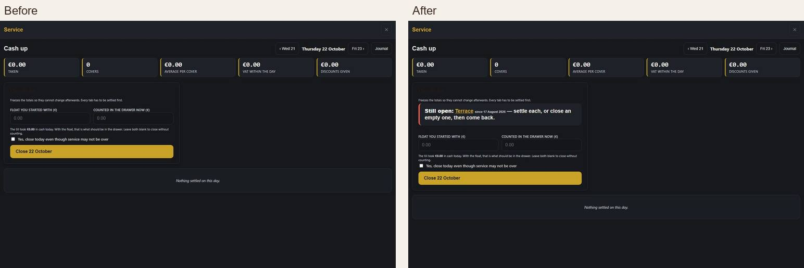 |
| **Timesheets**: a shift being worked offered "Void — zero hours"; decimal hours. | **Cash up**: an open tab stopped every close, unnamed until after the count. |
| 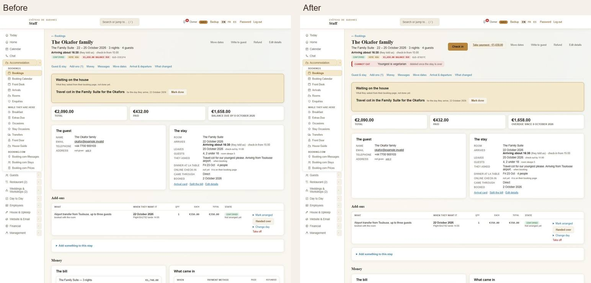 | 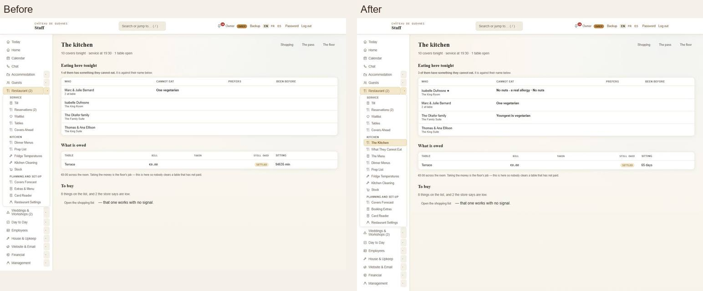 |
| **A booking's page**: no Check in on arrival day. | **The kitchen**: the nut allergy missing; "94635 min". |
| 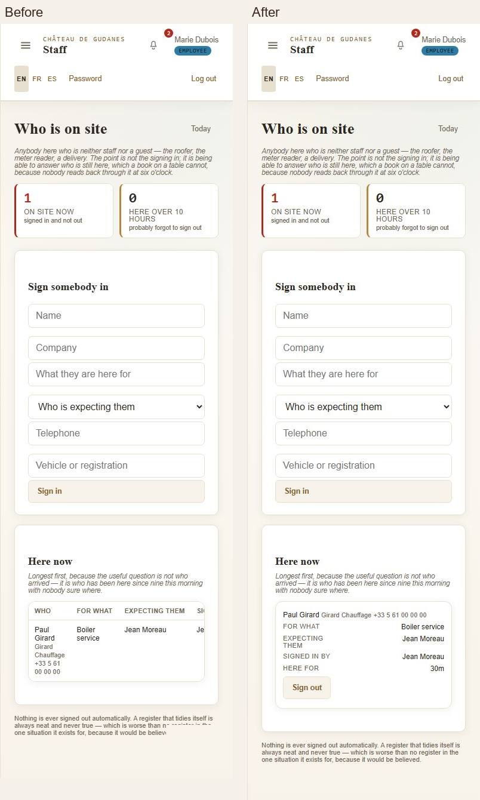 | |
| **Visitors on a phone**: the Sign out button off the edge. | |

---

## 1. Daily, every member of staff

| Page | What was wrong | State |
|---|---|---|
| Home (`/`) | Offered "Clock in" to somebody clocked in at 07:56. The view computed the open shift and never passed it to the page. | **Fixed** · test_staff_start_pages |
| Home | A room's checklist was eight rows, each repeating "The Okafor family arriving…"; Today and Tasks were grouped on 22 Oct, Home was missed. | **Fixed** |
| Today | "Home screen" and "My list" ran together (a `{#- -#}` comment ate the space). | **Fixed** |
| Today | Everybody due today read "Arrived today" from first thing. Now "Arriving today · about 16:30" until checked in. | **Fixed** |
| Today | A stay's request was printed twice on its card. | **Fixed** |
| Hours, everywhere | Decimal hours: 8h 07m printed "8.12h", which reads as 8h 12m. One week came out as 24.35, 24.4 and 24.36 on two pages. Shifts are now stored to the minute and printed "8h 07m". The payroll pack and its CSVs keep decimals. | **Fixed** |
| My Hours | The shift in progress was "a clocking that needs a look". | **Fixed** |
| Time Off | Cancel offered on taken leave, and the route allowed it, wiping days off the year. | **Fixed** |
| My Shifts / Availability / Time Off | "When you cannot work" had no link from any page an employee can open. | **Fixed** |
| Fire roll call | Linked only from the owner's reports index. Now in both sidebars. | **Fixed** |
| Five house pages on a phone | The row's button sat off the right edge: Cleaning Rounds, Lost Property, Visitors, My Availability, and Arrivals we cannot prepare for. They are now cards. | **Fixed** |
| Ten pages staff open | They linked to owner-only pages, which refused them: the arrivals sheet's booking and arrival card, the guest list's Stays, Fix, and the head links on lost property, cleaning, meters, linen, turnarounds and reply times. | **Fixed** · test_reach_and_allergies |
| Handover | A note's author was told they had not read it, and their own tap counted as a reader. | **Fixed** · test_what_the_house_relies_on |
| Team calendar | Today's column painted everyone at work in the time-off colour. | **Fixed** |
| Room checks | Anyone could add or remove lines on the list a room is walked against, with no confirm and no undo. Recording a walk with nothing ticked raised up to 12 room issues without saying so. | **Fixed** |
| Tasks week grid | Two identical empty squares per card (select and done), a hover-only priority dot, a bare ×. | **Open**: a card redesign that touches the live poll; worth its own pass |
| Calendar | A checklist's items still appear one by one in a day cell. | **Open**: left on 22 Oct for the same reason |

## 2. Daily, the desk and the owner

| Page | What was wrong | State |
|---|---|---|
| Front Desk, booking page, Breakfast, kitchen, allergy sheet | The guest's profile was found by the booking's link only (the Arrivals sheet uses email), so "No nuts – a real allergy" reached one page. There is now one lookup, link else email, with the booking's own check-in note first. | **Fixed** · test_reach_and_allergies |
| Breakfast | Counted the guests sleeping here tonight ("8 guests" for a table of four) and listed room requests. It now shows this morning's table, room by room, with "Cannot eat" first. | **Fixed** |
| Front Desk | "Room ready" ignored the room's own checklist. | **Fixed** |
| Front Desk | "2 free" and "Free tonight" with three rooms let (the house's limit). | **Fixed** |
| A booking's page | No Check in on arrival day; "Guest checked out" offered before arrival; an overdue balance not called overdue. | **Fixed** |
| Names | "The Okafor family" was greeted "Hi The," in letters and on the booking page, and asked for the surname "family". | **Fixed** |
| Approvals | The bulk button did a bare UPDATE: no email, no bell, no audit (CLAUDE.md's bulk rule). | **Fixed** |
| Approvals | Each decision left the queue. | **Fixed** |
| Approvals | A staff claim didn't say whose money it was. | **Fixed** |
| Approvals | Mileage claims never reach the queue or its count. | **Open**: needs the queue, the count and the bulk path; Mileage is now in the owner's menu |
| Expenses | "Remove" hard-deletes a paid expense and its receipt, with no audit. | **Open**: owner's call (void with a reason instead?) |
| "Here now" | Bookings list, booking page and Extras Due said "Here now" from the arrival date, not from check-in, and took it off a guest still at breakfast on her last day. Now one `stay_is_here`: in before today and not checked out, or checked in today. The booking page says "Arriving today" and "Leaving today". | **Fixed** · test_said_plainly (the Guest List's own panel is still by dates: Open) |

## 3. Restaurant, kitchen, till

| Page | What was wrong | State |
|---|---|---|
| The till under tonight's card | Publishing a card removed every wine, drink and coffee from the till, and no form could stop it. Now a tick on the dish ("Every night, whatever the card"), a one-off fix for the drinks courses, and a warning on Tonight's card. | **Fixed** · test_what_the_house_relies_on |
| The till | A party that had paid came back "booked in, not seated". Seating them again opened a second tab and held a prepaid dinner twice. | **Fixed** |
| The till | A tab opened by mistake could never close; one from 17 August blocked every cash-up. | **Fixed** |
| The till | "94635 min". | **Fixed** |
| Cash up | An open tab was named only after you submitted. It was counted by UTC date. | **Fixed** |
| Fridges | Anyone could widen a band or switch a fridge off, and the breach vanished with it. | **Fixed** |
| Kitchen screen, allergy sheet | Missed the profile allergy and the table's note. | **Fixed** |
| Kitchen pages | /chef and the allergy sheet were in no menu. | **Fixed** |
| Covers | Five different "covers tonight" figures (6, 10, 14…). | **Open**: one helper for who eats tonight; labels first |
| A prepaid Dinner at Gudanes table | No honest way to close with nothing extra. | **Open**: needs a prepaid close method in the journal |
| Receipts | Staff English on the guest's note ("2 covers", "Charge to their room"). | **Open** |
| Menu builder | 239 inputs open at once (9,000 px on a phone). | **Open** |
| Room pricing | Rate advice sits under the restaurant permission area. | **Open**: an access change, owner's call |

## 4. Money

| Page | What was wrong | State |
|---|---|---|
| On the books, Break-even, Money ahead (dinners) | A promo code was taken off `total_price` a second time; `total_price` is already net of it. | **Fixed** · test_what_the_house_relies_on |
| Money ahead | Left out guests in the house who still owe, and overdue atelier balances (€7,460 of €10,992 missing in the seeded window). | **Fixed** |
| Held, not earned | Read paid stamps, not the ledger, and dropped today's arrivals and stays in progress. | **Fixed** |
| Workshops | A registration waiting on the owner was money "past due", and Send statements would have billed them. | **Fixed** |
| Timesheets | A shift being worked was "to fix before payroll" with a Void button. The owner's own test clockings stood as 41 blockers against the payroll pack's 2. | **Fixed** |
| Revenue and occupancy | Booking.com stays are missing from most revenue and occupancy figures (Financials, On the books, pace). | **Open**: large; at least say so on those pages |
| Taxe de séjour | Three figures for what is owed; a "Held in account" setting nothing reads. | **Open** |
| Night margin | Expenses drop out once marked paid; capital spend is counted. | **Open** |
| Pace | The reports tile counts pending (31); the page counts confirmed (24). | **Open** |

## 5. Settings and records

| Page | What was wrong | State |
|---|---|---|
| Automation | Run now threw away unsaved switches; Save was only at the bottom of a 13,000 px page. | **Fixed** |
| Automation | "Not a timed job: it happens when a place frees up" under every untimed switch. | **Fixed** |
| Changes log | Printed a yes as "In booking total €1.00", and flags as 0/1. | **Fixed** |
| Is mail going out? | Said On while the Guest emails switch was holding every automatic letter. | **Fixed** |
| Sidebar | Twenty pages lit no menu line. The upkeep schedule, weather jobs, What's On, Social, Money ahead, taxe de séjour and Mileage were reachable only by search. "Extras & Menu" opened Booking Extras. | **Fixed** |
| Back links | Seventeen pages said "← Management". | **Fixed** |
| Go-live checklist | "Siret, tva number…" lower-cased, and optional drawn in the danger red. | **Fixed** · test_said_plainly. No "Fix it" links yet, and optional items still count as failing: **Open** |
| All the reports, Access levels | Grouped by permission-area names, not the sidebar's. | **Open** |
| Terms | Saving keeps no version and no audit line. | **Open**: owner's call |
| "Housekeeping" job | Declines booking requests and emails Booking.com guests; the name says neither. | **Open**: rename needs the owner's word |

## 6. Across the side (the systemic ones)

- **Page introductions read like a history of why the page was built** ("…the
  two live in different tables", "…nothing has ever read them back"). About
  forty pages. **Open**: a copy pass. Rewrite each as one plain sentence saying
  what the page is for, and move the reasoning into comments.
- **Workshop vocabulary**: workshop / retreat / atelier, session / sitting,
  places / spots / seats. **Open**: the owner's choice of words.
- **Sidebar labels vs page headings**: Who Works Here / Team, Shifts / Shift
  Schedule. **Open**, apart from Booking Extras.
- **Inputs labelled only by placeholder**: about 200. **Open**. Some fixed on
  the way (handover, availability, room checks, approvals).
- **Bare × delete buttons with no accessible name** on contacts, announcements,
  the profile, vendors, breakfast, documents, filings and tonight's card: each
  says Remove (or Delete, or Take off) with a name. The onboarding, leaving and
  equipment rows ask first. **Fixed** · test_said_plainly

## Small things, fixed on the way (test_said_plainly)

- Dates in words: an overdue supplier ("oldest due"), exit interviews, meter
  readings.
- A seven-digit meter no longer prints as "1.23457e+06".
- A mileage claim's state in words ("Waiting for approval"), not "pending".
- "1 child", "1 breakage has", "1 of these stays was" (the "(s)" family).
- The run sheet's "the the couple".
- "They are written to to say so" is now "We will write to tell them".
- An enquiry was "Asked", not "Joined".
- A transfer says "Pickup", not "pickup".
- The calendar's "Requests" button is "Bookings", the page it opens.
- Booking.com prices' "The list as data" is "Download the list".
- Extras Due's "Arranged" (it looked like a state) is "Mark arranged…".
- The Guest List leaves out the old "[Former register entry: 2026-08-10…]" lines
  under To know.
- A colleague's phone number can be tapped to call.
- Mark inactive asks first.
- The manual's "I've read this" is also at the end of the manual.
- Breakfast says tomorrow's count on its own line, from tonight's stays.
- The Front Desk calls an empty room on a full night "Not for sale tonight".

## Data noticed on the way (for the owner, not code)

- The Terms name "Château de Gudanes, SASU, RCS Foix 106 121 783". Company &
  Insurance lists only "SCI Torrents", and without its numbers.
- The Ben, Jasmine and Karina access levels still say "STARTING POINT — guessed,
  please edit".
- The local copy holds 51 identical test time-off requests for Marie Dubois
  (16–18 September).

## Tests

| Suite | Checks | Holds |
|---|---|---|
| `tests/test_staff_start_pages.py` | 38 | Home, Today, hours, time off, links, dates, phone cards |
| `tests/test_what_the_house_relies_on.py` | 52 | Timesheets, workshops, approvals, the till, fridges, room checks, handover, names, desk, booking page, money, settings |
| `tests/test_reach_and_allergies.py` | 19 | Allergies on every page that matters, links staff can open, the sidebar |
| `tests/test_said_plainly.py` | 32 | Here now, breakfast's two counts, buttons with names, the small words |

Every check was broken on purpose (a negative control) and seen to fail, then
restored.
